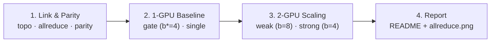
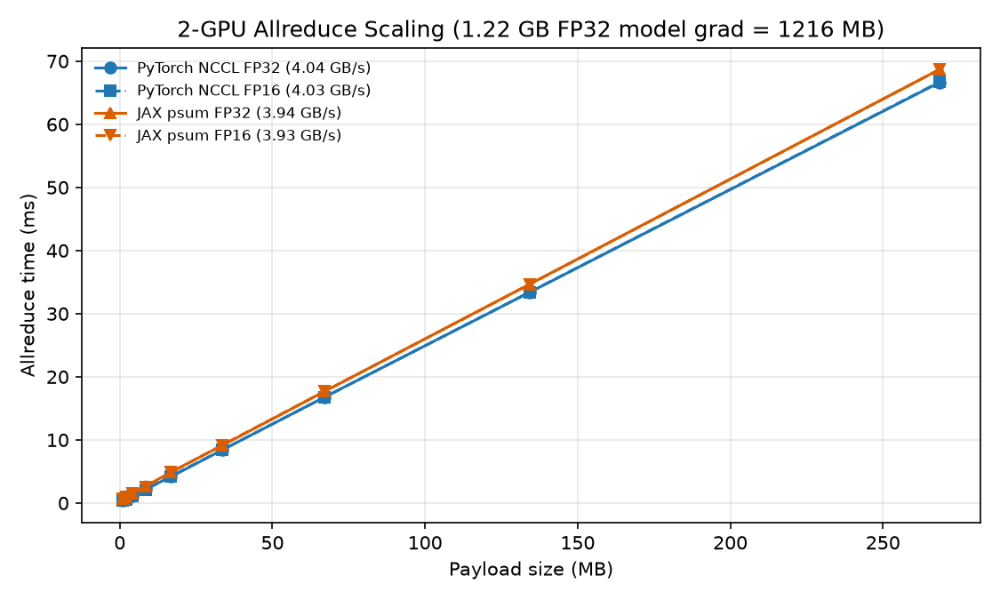

# PyTorch vs. JAX: Multi-GPU Scaling on 2× NVIDIA T4

**Does adding a second GPU over standard PCIe actually speed up transformer training—and how do PyTorch and JAX compare once the math is identical?**

[](LICENSE)
[](pyproject.toml)
[-76B900.svg)](results/2026-11-17/topo.txt)
[](tests/)

**On this page:** [TL;DR](#tldr) · [The Problem](#the-problem--how-it-works) · [Results](#benchmark-results) · [Hypotheses vs. Outcomes](#hypotheses-vs-outcomes) · [What I Learned](#what-i-learned) · [Architectural Choices](#architectural-choices) · [Limitations & Next Steps](#limitations--next-steps) · [Quickstart](#quickstart)

---

### TL;DR

- **On 1 GPU, PyTorch wins (`+26%`):** `torch.compile` reaches **5,485 tok/s** vs. JAX's **4,369 tok/s**, while using ~2 GB less memory.
- **On 2 GPUs, JAX overtakes PyTorch (`81%` vs. `63%` weak-scaling efficiency):** Over a `~4 GB/s` PCIe link, JAX hides roughly two-thirds of the gradient sync behind backward compute, while PyTorch hides about a quarter.
- **Fixed-batch ("strong") scaling fails on PCIe:** Splitting the same batch across two T4s cuts compute per card while gradient traffic stays `1.22 GB`—making 2-GPU PyTorch DDP **23% slower than 1 GPU**.

---

## The Problem & How It Works

Suppose a small ML team is renting budget dual-GPU nodes (`2× NVIDIA T4`, 16 GB VRAM each, connected over PCIe with no NVLink) to adapt a ~304M-parameter GPT-2-medium transformer. Before committing to multi-GPU jobs, they need clear answers to two questions:

1. **Is a second PCIe GPU worth it?** Does adding a second card double throughput, or does gradient synchronization eat the gain unless global batch size grows too?
2. **PyTorch or JAX?** When both frameworks execute the exact same math on identical silicon, which one scales better across a slow host bridge?

### How the Benchmark Works

Each stage enforces a strict pass/fail gate before the next stage can run, across **3 fresh Python processes × 30 timed steps** per cell:

1. **Measure the link (`allreduce`):** Time raw GPU-to-GPU transfers (`1–256 MB`) to establish the theoretical sync cost for the model's `1.22 GB` FP32 gradients.
2. **Verify identical math (`parity` + `gate`):** Load the same NumPy weights into PyTorch and JAX to confirm matching logits (`< 1e-3`), then freeze a shared per-GPU batch size (`b*=4`) where FP16 tensor cores engage.
3. **Benchmark 1 GPU (`single`):** Time PyTorch (`eager` and `torch.compile`) and JAX (`@jax.jit`) on one T4 with synthetic batches pre-allocated in VRAM.
4. **Scale to 2 GPUs (`scale`):** Time **weak scaling** (doubled global batch) and **strong scaling** (same global batch split in half), subtracting 1-GPU step time from 2-GPU step time to measure communication overlap.



---

## Benchmark Results

<!-- results:start -->
**Machine:** 2× Tesla T4 · CC 7.5 · 15360 MiB each · link: `PHB` · driver `580.178.04` · CUDA `13.2`

**Gate (batch\*=4, cmp=4):** FP16 `0.498 s` vs FP32 `1.292 s` (`2.60×`), `9.07 GB` peak, `8.1` / `65.0` TFLOP/s

| Stack | 1 GPU (tok/s) | 2 GPU Weak (tok/s, eff, Δ vs sync) | 2 GPU Strong (tok/s, eff) |
|---|---|---|---|
| PyTorch (`compile`) | 5,485 [5,124–5,816] | 6,889 [6,726–7,107] (62.8%, Δ +221 ms vs 301 ms) | 4,201 [4,175–4,274] (38.3%) |
| JAX (`jit`) | 4,369 [4,224–4,430] | 7,116 [6,941–7,199] (81.4%, Δ +107 ms vs 301 ms) | 5,097 [5,057–5,126] (58.3%) |
| PyTorch (`eager`, unused for 2 GPU) | 3,957 [3,825–4,048] | — | — |

**Correctness (FP32 forward):** block `1.19e-06`, full model `1.48e-05` (`< 1e-3`) ✓

**Allreduce (FP32):** NCCL `α = 107.0 µs`, `β = 4.04 GB/s` (`R² = 1.0000`, 1.22 GB sync est `301 ms`); JAX `psum` `β = 3.94 GB/s`

**Versions:** Python `3.13.16` · PyTorch `2.15.0+cu132` · JAX `0.12.0.1` / jaxlib `0.12.0.1` · cuDNN `92600` · NCCL `2.30.7` · git `3b73071`
<!-- results:end -->

**How to read this:** On one card, PyTorch `compile` is ~26% faster than JAX `jit`. Adding a second card introduces a `~301 ms` PCIe gradient sync—JAX overlaps roughly two-thirds of that transfer with backward math (`+107 ms` net penalty), overtaking PyTorch (`+221 ms` net penalty) in 2-GPU throughput.



<details>
<summary>Detailed Telemetry, Memory &amp; Overlap Breakdown (from results/2026-11-17/*.json)</summary>

#### 1. Interconnect Calibration & Overlap Math ([`allreduce.json`](results/2026-11-17/allreduce.json), [`scale.json`](results/2026-11-17/scale.json))

| Metric | PyTorch (`NCCL` / `DDP`) | JAX (`psum` / `NamedSharding`) |
|---|---|---|
| **FP32 Bandwidth (`β`)** | 4.04 GB/s (`R² = 0.999996`) | 3.94 GB/s (`R² = 0.999987`) |
| **Zero-Byte Latency (`α`)** | 107.0 µs | 534.1 µs |
| **FP16 Bandwidth (`β`)** | 4.03 GB/s (`α = 77.5 µs`) | 3.93 GB/s (`α = 507.2 µs`) |
| **Est. `1.22 GB` FP32 Sync Time** | 301.3 ms | 309.3 ms |
| **Weak-Scaling Step Delta (`t₂ − t₁`)** | +221.2 ms (`373.4 → 594.6 ms`) | +106.9 ms (`468.7 → 575.6 ms`) |
| **Sync Overlapped Behind Backward** | ~80.1 ms (~27%) | ~202.4 ms (~65%) |

#### 2. Step Time, Compute Utilization, Memory & Compile Tax ([`single.json`](results/2026-11-17/single.json), [`scale.json`](results/2026-11-17/scale.json))

| Configuration | Median Step (ms) | Achieved TFLOP/s (% of 65) | Peak VRAM (GB) | Compile / Step-0 Tax | Loss (`step 0 → end`) |
|---|---:|---:|---:|---:|---|
| PyTorch `eager` (1 GPU, `b=4`) | 517.6 | 7.79 (12.0%) | 9.07 | 0.85 s step-0 | `7.129 → 6.913` |
| PyTorch `compile` (1 GPU, `b=4`) | **373.4** | **10.80 (16.6%)** | 9.04 | 5.03 s step-0 (`0` breaks) | `7.129 → 6.913` |
| JAX `jit` (1 GPU, `b=4`) | 468.7 | 8.60 (13.2%) | 11.01 | 3.37 s AOT + 0.51 s step-0 | `7.129 → 6.907` |
| PyTorch DDP `compile` (2 GPU Weak, `b=4×2`) | 594.6 | 13.57 | **8.28** | 27.90 s step-0 | `7.148 → 6.924` |
| JAX `jit` Mesh (2 GPU Weak, `b=4×2`) | **575.6** | **14.01** | 11.03 | 3.31 s AOT + 1.01 s step-0 | `7.146 → 6.928` |
| PyTorch DDP `compile` (2 GPU Strong, `b=2×2`) | 487.5 | 8.27 | **6.70** | 27.60 s step-0 | `7.139 → 6.902` |
| JAX `jit` Mesh (2 GPU Strong, `b=2×2`) | **401.8** | **10.04** | 8.06 | 3.17 s AOT + 0.83 s step-0 | `7.129 → 6.907` |

</details>

---

## Hypotheses vs. Outcomes

Predictions were committed in [`README.md`](README.md) before any T4 hardware run (`c5dff4b`) and left standing as recorded:

| Hypothesis | Pre-Run Expectation | Measured Outcome | Status |
|---|---|---|---|
| **PCIe Interconnect** | No NVLink (`PHB`); `~4 GB/s` link (`~300 ms` sync) | `PHB` topology; NCCL `4.04 GB/s` (`301 ms` est.) | **Confirmed** |
| **FP16 Tensor Cores** | FP16 beats FP32 by `>= 1.5×` at `>= 8 GB` | `2.60×` speedup at `9.07 GB` peak | **Confirmed** |
| **1-GPU Parity** | JAX `jit` and PyTorch land close on 1 GPU | PyTorch `compile` faster by ~26% | **Falsified** |
| **Weak Scaling** | `< 2×` speedup, bounded by sync cost | PyTorch 62.8% eff; JAX 81.4% eff | **Confirmed** |
| **Strong Scaling** | Lower efficiency than weak scaling | PyTorch dropped to 38.3%; JAX to 58.3% | **Confirmed** |

---

## What I Learned

1. **Fastest on 1 GPU ≠ Fastest on 2 GPUs:**  
   `torch.compile` wins single-card throughput easily, yet XLA's asynchronous all-reduce scheduling hides nearly three times as much communication latency behind the backward pass—flipping the ranking once a second card is added.

2. **Static compilation costs VRAM headroom:**  
   XLA pre-allocates static buffer plans across the 24-layer `lax.scan` loop, requiring roughly 2 GB more peak memory than PyTorch's caching allocator. Freezing `batch=4` was necessary so both stacks fit cleanly on 16 GB T4s without gradient checkpointing.

3. **Default shortcuts can quietly invalidate a benchmark:**  
   T4 GPUs lack `bfloat16` tensor cores and FlashAttention-2. Letting PyTorch use `scaled_dot_product_attention` by default would have tested two different attention algorithms; implementing explicit `einsum` attention, `tanh`-GELU, and dynamic FP16 loss scaling in both stacks ensured true numerical parity.

4. **PyTorch and JAX need separate environments:**  
   Modern PyTorch and JAX CUDA wheels pull conflicting `nvidia-nccl` and `nvidia-cudnn` versions (`cu13` vs. `cu12`). Isolating `.venv-torch` and `.venv-jax`—while keeping specs, timing, and gates framework-free—eliminated dependency breaks cleanly.

<details>
<summary>Engineering War Stories (XLA OOMs, CUDA 13 vs. 12, Notebook Env Leakage)</summary>

- **JAX `batch=6/8` OOMs:** When PyTorch's batch search initially selected `batch=8` (`13.05 GB`), JAX failed with `RESOURCE_EXHAUSTED` trying to allocate `13.55 GiB` inside `GPU_0_bfc`; even `batch=6` (`11.06 GB` PyTorch) requested `10.58 GiB` on top of `3.65 GiB` optimizer/parameter state (`~14.23 GiB` total). Stopping PyTorch's search at the first even batch `>= 8.5 GB` (`b*=4`) kept PyTorch at `9.07 GB` and JAX at `11.01 GB`.
- **DDP memory vs. compile tax:** Setting `gradient_as_bucket_view=True` on `DDP(torch.compile(model))` reduced PyTorch's 2-GPU peak memory from `9.04 GB` to `8.28 GB`, but increased first-step compile time from `5.03 s` to `27.90 s` across bucket splits (vs. JAX's `3.3 s` AOT compile).
- **Notebook environment leakage:** Jupyter kernels export `MPLBACKEND=module://matplotlib_inline.backend_inline`, which crashes headless `matplotlib` inside clean virtual environments unless `MPLBACKEND=Agg` is forced.

</details>

---

## Architectural Choices

| Decision | Choice Made | Why |
|---|---|---|
| **Model Scale** | GPT-2-medium body, `vocab=1024` (304M params) | Small enough to fit optimizer state + batch `> 1` on 16 GB; large enough to avoid kernel-launch overhead. |
| **Attention Math** | Explicit `einsum` + FP32 softmax | Prevents PyTorch-only `SDPA` memory-efficient kernels from biasing memory and speed on `sm_75`. |
| **JAX Stack** | Pure JAX pytrees + `lax.scan` + `NamedSharding` | Direct control over NumPy weight loading, FP16/FP32 casting, and explicit data-parallel sharding. |
| **Environments** | Separate `.venv-torch` and `.venv-jax` | Prevents CUDA 13 vs. CUDA 12 wheel conflicts while sharing pure-Python measurement logic. |
| **Timing Protocol** | 3 fresh subprocesses × 30 steps; GPU-resident pool | Eliminates cross-run allocator/Inductor cache bleed and keeps host CPUs outside the timer. |

---

## Limitations & Next Steps

- **Limitations:** Synthetic batches live in GPU memory (DataLoader I/O is excluded); Chrome profiler traces are omitted from git to keep artifacts small, so the 1-GPU kernel-level cause isn't exported to `single.json`; and `inspect_hlo_allreduce` detected `all_reduce_count: 4` in JAX HLO though its regex returned `all_reduce_bytes: 0` on JAX 0.12's tuple syntax.
- **Next Directions:**
  1. **FP16 Gradient Compression Hooks:** Halve the `1.22 GB` sync payload (`~301 ms → ~151 ms` est.) to test if PyTorch DDP closes its scaling gap.
  2. **Activation Checkpointing (`jax.remat`):** Re-test `batch=8` with matched checkpointing in both frameworks to push T4 utilization higher.
  3. **Top-Ops Trace Summaries:** Export the top 10 CUDA kernels directly into `single.json` to pinpoint the 1-GPU `torch.compile` vs. JAX `jit` gap.

---

## Quickstart

### Local CPU Tests

```bash
git clone https://github.com/adityavsb/pytorch-jax-gpt-training.git
cd pytorch-jax-gpt-training
python3 -m venv .venv-dev
.venv-dev/bin/pip install -e ".[torch,jax,dev]"
.venv-dev/bin/pytest -q
PYTHON_BIN=.venv-dev/bin/python bash scripts/smoke_cpu.sh
```

### Full 2× NVIDIA T4 Run

```bash
git clone https://github.com/adityavsb/pytorch-jax-gpt-training.git
cd pytorch-jax-gpt-training
bash scripts/setup.sh          # builds isolated .venv-torch and .venv-jax environments
bash scripts/run_all.sh        # runs all gated stages and updates README.md
bash scripts/package_results.sh
```

<details>
<summary>Repository Layout</summary>

```text
pytorch-jax-gpt-training/
├── README.md                  # Summary report, results, and reproduction guide
├── pyproject.toml             # Package definition ("bench"), [torch]/[jax]/[dev] extras
├── requirements/              # Pinned PyTorch (CUDA 13) and JAX (CUDA 12) dependencies
├── scripts/                   # setup.sh, run_all.sh, smoke_cpu.sh, package_results.sh
├── src/bench/                 # spec, models, steps, timing, gates, stage CLIs, report
├── results/2026-11-17/        # Committed 2x NVIDIA Tesla T4 outputs, logs, and allreduce.png
└── tests/                     # 16 CPU-only unit, parity, sharding, DDP, and report tests
```

</details>

---

*Disclaimer: The dual-T4 cloud adaptation scenario is synthetic and illustrative; all hardware specs, bandwidth fits, parity checks, step timings, and scaling efficiencies are physical measurements committed in [`results/2026-11-17/`](results/2026-11-17/).*
