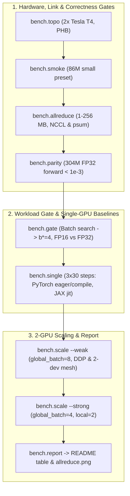

# PyTorch vs. JAX Data-Parallel Scaling on 2× NVIDIA Tesla T4 GPUs

**Controlled single-card parity, PCIe interconnect calibration, and multi-GPU overlap dynamics for a 304M-parameter GPT-2-medium transformer on Turing (`sm_75`).**

[](LICENSE)
[](pyproject.toml)
[-76B900.svg)](results/2026-11-17/topo.txt)
[](tests/)

Compare **PyTorch** (`eager`, `torch.compile`, and `DistributedDataParallel`) against **pure JAX** (`@jax.jit` with `lax.scan` and `NamedSharding` batch sharding) on physical **2× NVIDIA Tesla T4** hardware connected via a PCIe host bridge (`PHB`, no NVLink). Rather than declaring a single framework winner, this benchmark calibrates the raw interconnect (`4.04 GB/s` NCCL FP32, `R² = 1.0000`), verifies numerical parity (`1.48e-05` max logit diff), and isolates **single-card compute vs. multi-GPU communication overlap** across **3 isolated subprocesses × 30 timed steps** per cell. All CPU correctness, parity, DDP, and sharding tests run offline; hardware runs are committed under [`results/2026-11-17/`](results/2026-11-17/).

**On this page:** [The Engineering & Business Question](#the-engineering--business-question) · [What I Learned](#what-i-learned-systems-reality-vs-theoretical-claims) · [Core Hypotheses & Outcomes](#core-hypotheses--empirical-outcomes) · [Architecture](#architecture) · [Benchmark Results](#benchmark-results-1-vs-2-nvidia-tesla-t4) · [Architectural Choices](#architectural-choices--trade-offs) · [Limitations & Next Directions](#limitations--proposed-next-engineering-directions-a-b-c) · [Quickstart](#quickstart--reproducibility) · [Repo Layout](#repository-layout)

---

## The Engineering & Business Question

> *Once a training step is large enough to saturate a 16 GB T4, how much throughput does a second T4 over PCIe actually return—and should a small ML team bet on PyTorch (`torch.compile` + DDP) or JAX (`@jit` + `jax.sharding`)?*

Consider a realistic infrastructure decision for a small applied-ML team provisioning budget dual-GPU cloud nodes (`2× Tesla T4`, 16 GB VRAM each, 4 vCPUs, ~31 GB RAM) for internal domain adaptation of a ~304M-parameter decoder-only transformer:

1. **Weak vs. Strong Scaling Budget:** On nodes without NVLink, adding a second GPU duplicates the `~1.22 GB` FP32 gradient payload across a `~4 GB/s` PCIe host bridge every step. Does doubling to two T4s justify itself if global batch size is fixed (**strong scaling**), or only when global batch doubles (**weak scaling**)?
2. **Framework & Compiler Selection:** On 1 GPU, compiler fusion (`torch.compile` vs. `@jax.jit`) governs kernel efficiency. On 2 GPUs, **asynchronous backward/all-reduce overlap** governs how much of that `~301 ms` sync tax is hidden.

### How the Dual-Stack Benchmark Works

1. **Link Calibration (`allreduce`):** Before any model runs, both PyTorch NCCL and JAX `psum` run an FP16/FP32 all-reduce sweep (`1 MB` to `256 MB`) to fit `t = α + n/β` and compute the theoretical sync time for the model's `1.22 GB` FP32 gradient buffer.
2. **Correctness & Workload Gates (`parity` + `gate`):** Identical NumPy weights are loaded into both stacks to verify FP32 forward parity (`< 1e-3`). PyTorch then runs a batch search and precision gate to freeze a common per-GPU batch `b*` where tensor cores engage (`>= 1.5×` FP16 speedup) and step memory exceeds `8 GB`.
3. **Single-Card Baseline (`single`):** Both stacks run 3 fresh subprocesses × 30 timed steps at `b*` (`eager` vs. `torch.compile` vs. JAX `jit`) with synthetic token batches pre-allocated on GPU.
4. **2-GPU Scaling (`scale`):** PyTorch (`DDP` with the winning 1-GPU mode) and JAX (2-device `Mesh` + `NamedSharding`) run weak scaling (`global_batch = 2·b*`) and strong scaling (`global_batch = b*`), comparing `Δ step = t₂ − t₁` directly against the measured all-reduce estimate.

---

## What I Learned: Systems Reality vs. Theoretical Claims

Running the full gated benchmark on physical `2× Tesla T4` hardware surfaced five concrete systems findings that only show up when both frameworks run on the exact same silicon and interconnect:

1. **The 1-GPU vs. 2-GPU Performance Inversion (Compute vs. Overlap):**  
   On 1 T4, `torch.compile` (`0` graph breaks) beat JAX `jit` by **25.5%** (`5,485` vs. `4,369 tok/s`). Yet on 2 T4s (weak scaling), **JAX overtook PyTorch** (`7,116` vs. `6,889 tok/s`, **81.4%** vs. **62.8%** scaling efficiency). Subtracting 1-GPU step time from 2-GPU step time against the `301–309 ms` link estimate reveals why: **XLA overlapped `~202 ms` (65%)** of the all-reduce behind backward compute (`Δ = +106.9 ms`), whereas **PyTorch DDP overlapped `~80 ms` (27%)** (`Δ = +221.2 ms`).

2. **XLA's Static Buffer Tax on 16 GB VRAM (`batch=6` and `batch=8` OOM in JAX):**  
   In an initial run where PyTorch's search pushed to `b*=8`, PyTorch fit comfortably at `13.05 GB` (`eager`) / `12.98 GB` (`compile`), while JAX crashed with `RESOURCE_EXHAUSTED` trying to allocate `13.55 GiB` inside `GPU_0_bfc`; even `batch=6` (`11.06 GB` in PyTorch) requested `10.58 GiB` over `3.65 GiB` state in JAX (`~14.23 GiB` total). Stopping the gate search at the first even batch `>= 8.5 GB` (`b*=4`) kept both frameworks inside the 15.0 GiB T4 envelope (`9.07 GB` PyTorch, `11.01 GB` JAX) without gradient checkpointing.

3. **Turing (`sm_75`) Constraints & Eliminating Hidden Attention Confounds:**  
   The Tesla T4 lacks native `bfloat16` tensor cores and Ampere FlashAttention-2 (`sm_80+`) kernels. Relying on PyTorch's default `scaled_dot_product_attention` would silently select its memory-efficient kernel while leaving JAX on standard materialized attention—confounding both memory and throughput. Implementing explicit `einsum` causal attention with FP32 softmax, `tanh`-approximated GELU, and matched dynamic FP16 loss scaling kept both stacks numerically identical (`1.48e-05` max logit difference).

4. **CUDA Wheel Divergence (`cu13` vs. `cu12`) & Notebook Kernel Leakage:**  
   `torch==2.15.0` resolved CUDA 13 (`nvidia-nccl-cu13==2.30.7`), while `jax[cuda12]==0.12.0.1` resolved CUDA 12 (`nvidia-nccl-cu12==2.32.6`). Trying to force both into one Python environment breaks dependency resolution; isolating `.venv-torch` and `.venv-jax` solved it cleanly. In addition, Jupyter kernels export `MPLBACKEND=module://matplotlib_inline.backend_inline` to child shells, crashing headless plotting inside clean venvs until `MPLBACKEND=Agg` is forced.

5. **Strong Scaling Hits the `4.04 GB/s` `PHB` PCIe Wall:**  
   `nvidia-smi topo -m` confirmed `PHB` (PCIe Host Bridge) and NCCL logs confirmed `Channel 00 : 0[0] -> 1[1] via SHM/direct`, yielding `4.04 GB/s` (`301.3 ms` per `1.22 GB` FP32 sync). When global batch stays fixed at `4` (`2` per GPU), per-GPU compute halves while gradient sync stays `1.22 GB`, causing 2-GPU PyTorch DDP (`4,201 tok/s`) to run **23.4% slower than 1-GPU PyTorch `compile` (`5,485 tok/s`)**.

---

## Core Hypotheses & Empirical Outcomes

Predictions 1–3 were committed in [`README.md`](README.md) prior to any T4 execution (`c5dff4b`) and retained unaltered alongside the measured outcomes:

| ID | Hypothesis / Prediction | Pre-Registered Expectation | Empirical Outcome (`results/2026-11-17/`) | Status |
|---|---|---|---|---|
| **H0** | **PCIe Interconnect Ceiling:** Two T4s meet over PCIe host bridge (`~4 GB/s`), making `1.22 GB` FP32 sync `~300 ms`. | Link is `PHB` (not NVLink); `R² >= 0.98`; linear sync estimate `~300 ms`. | Link `PHB` (`SHM/direct`); NCCL FP32 **`4.04 GB/s`** (`R² = 1.0000`), est. **`301.3 ms`**; JAX `psum` **`3.94 GB/s`** (**`309.3 ms`**). | **Confirmed** |
| **H1** | **FP16 Tensor Core Gate:** FP16 autocast beats FP32 on 1 T4 by a wide margin once tensor cores engage. | FP16 speedup `>= 1.5×` with non-overlapping distributions and `>= 8 GB` allocated. | At `b*=4`: FP16 **`0.498 s`** vs. FP32 **`1.292 s`** (**`2.60×`**, non-overlapping), **`9.07 GB`** peak. | **Confirmed** |
| **H2** | **1-GPU Framework Parity:** On 1 T4, JAX `jit` and the chosen PyTorch FP16 mode land close. | Median step times land within run-to-run step spread. | PyTorch `compile` (**`5,485 tok/s`**, `373.4 ms`) beat JAX `jit` (**`4,369 tok/s`**, `468.7 ms`) by **25.5%** (non-overlapping). | **Falsified** |
| **H3** | **Weak Scaling Sub-Linearity:** 2-GPU weak scaling lands under `2×` by roughly the measured all-reduce sync cost. | `Δ step <= 1.25 × 301.3 ms` (`<= 377 ms`); efficiency `< 100%`. | PyTorch DDP: **62.8%** (`6,889 tok/s`, `Δ = +221.2 ms`). JAX `jit`: **81.4%** (`7,116 tok/s`, `Δ = +106.9 ms`). | **Confirmed** |
| **H4** | **Strong Scaling Drop:** Halving per-GPU batch drops efficiency below weak scaling because sync bytes stay fixed. | Strong scaling efficiency `<` weak scaling efficiency in both stacks. | PyTorch dropped **62.8% → 38.3%** (`4,201 tok/s`); JAX dropped **81.4% → 58.3%** (`5,097 tok/s`). | **Confirmed** |

---

## Architecture



---

## Benchmark Results (1× vs. 2× NVIDIA Tesla T4)

> [!NOTE]
> The summary block below is generated directly from [`results/2026-11-17/`](results/2026-11-17/) by `python -m bench.report --results results/2026-11-17 --readme README.md`.

<!-- results:start -->
**Machine:** 2× Tesla T4 · CC 7.5 · 15360 MiB each · link: `PHB` · driver `580.178.04` · CUDA `13.2`

**Gate (batch\*=4, cmp=4):** FP16 `0.498 s` vs FP32 `1.292 s` (`2.60×`), `9.07 GB` peak, `8.1` / `65.0` TFLOP/s

| Stack | 1 GPU (tok/s) | 2 GPU Weak (tok/s, eff, Δ vs sync) | 2 GPU Strong (tok/s, eff) |
|---|---|---|---|
| PyTorch (`compile`) | 5,485 [5,124–5,816] | 6,889 [6,726–7,107] (62.8%, Δ +221 ms vs 301 ms) | 4,201 [4,175–4,274] (38.3%) |
| JAX (`jit`) | 4,369 [4,224–4,430] | 7,116 [6,941–7,199] (81.4%, Δ +107 ms vs 301 ms) | 5,097 [5,057–5,126] (58.3%) |
| PyTorch (`eager`, unused for 2 GPU) | 3,957 [3,825–4,048] | — | — |

**Correctness (FP32 forward):** block `1.19e-06`, full model `1.48e-05` (`< 1e-3`) ✓

**Allreduce (FP32):** NCCL `α = 107.0 µs`, `β = 4.04 GB/s` (`R² = 1.0000`, 1.22 GB sync est `301 ms`); JAX `psum` `β = 3.94 GB/s`

**Versions:** Python `3.13.16` · PyTorch `2.15.0+cu132` · JAX `0.12.0.1` / jaxlib `0.12.0.1` · cuDNN `92600` · NCCL `2.30.7` · git `3b73071`
<!-- results:end -->

### 1. Interconnect Calibration & Communication Overlap

Primary sources: [`results/2026-11-17/allreduce.json`](results/2026-11-17/allreduce.json) and [`results/2026-11-17/scale.json`](results/2026-11-17/scale.json).


| Metric | PyTorch (`NCCL` / `DDP`) | JAX (`psum` / `NamedSharding`) |
|---|---|---|
| **Measured FP32 Bandwidth (`β`)** | **4.04 GB/s** (`R² = 0.999996`) | **3.94 GB/s** (`R² = 0.999987`) |
| **Zero-Byte Latency (`α`)** | **107.0 µs** | **534.1 µs** |
| **Measured FP16 Bandwidth (`β`)** | **4.03 GB/s** (`α = 77.5 µs`) | **3.93 GB/s** (`α = 507.2 µs`) |
| **Est. `1.22 GB` FP32 Sync Time** | **301.3 ms** | **309.3 ms** |
| **Observed Weak-Scaling `Δ = t₂ − t₁`** | **+221.2 ms** (`373.4 → 594.6 ms`) | **+106.9 ms** (`468.7 → 575.6 ms`) |
| **Implied Sync Hidden by Overlap** | **~80.1 ms (~27%)** | **~202.4 ms (~65%)** |

### 2. Step Timing, Compilation Tax, Memory & Convergence

Primary sources: [`results/2026-11-17/single.json`](results/2026-11-17/single.json) and [`results/2026-11-17/scale.json`](results/2026-11-17/scale.json).

| Configuration | Median Step (ms) | Achieved TFLOP/s (% of 65) | Peak VRAM (GB) | Compile / Step-0 Tax | Loss (`step 0 → end`) |
|---|---:|---:|---:|---:|---|
| **PyTorch `eager` (1 GPU, `b=4`)** | 517.6 | 7.79 (12.0%) | 9.07 | `0.85 s` step-0 | `7.129 → 6.913` |
| **PyTorch `compile` (1 GPU, `b=4`)** | **373.4** | **10.80 (16.6%)** | 9.04 | `5.03 s` step-0 (`0` breaks) | `7.129 → 6.913` |
| **JAX `jit` (1 GPU, `b=4`)** | 468.7 | 8.60 (13.2%) | 11.01 | `3.37 s` AOT + `0.51 s` step-0 | `7.129 → 6.907` |
| **PyTorch DDP `compile` (2 GPU Weak, `b=4×2`)** | 594.6 | 13.57 | **8.28** | `27.90 s` step-0 | `7.148 → 6.924` |
| **JAX `jit` Mesh (2 GPU Weak, `b=4×2`)** | **575.6** | **14.01** | 11.03 | `3.31 s` AOT + `1.01 s` step-0 | `7.146 → 6.928` |
| **PyTorch DDP `compile` (2 GPU Strong, `b=2×2`)** | 487.5 | 8.27 | **6.70** | `27.60 s` step-0 | `7.139 → 6.902` |
| **JAX `jit` Mesh (2 GPU Strong, `b=2×2`)** | **401.8** | **10.04** | 8.06 | `3.17 s` AOT + `0.83 s` step-0 | `7.129 → 6.907` |

*Note on memory and compile tax:* PyTorch DDP (`gradient_as_bucket_view=True` + DDPOptimizer bucket splitting) lowers per-GPU peak memory from `9.04 GB` to `8.28 GB`, at the cost of a `~27.9 s` first-step recompilation across bucket boundaries. JAX's AOT compilation stays near `3.2–3.4 s` across 1-GPU and 2-GPU meshes.

---

## Architectural Choices & Trade-offs

| Decision | Choice Made | Alternative Rejected | Rationale |
|---|---|---|---|
| **Model Scale** | GPT-2-medium body, `vocab=1024` (**303,884,288** params) | 124M small or 774M large | `124M` stays dispatch-bound; `774M` (`~12.4 GB` optimizer state) leaves no room for batch > 1 on 16 GB. Small vocab isolates transformer compute/sync from embedding bloat. |
| **Attention Kernel** | Explicit `einsum` + causal mask + FP32 softmax | PyTorch `SDPA` | T4 (`sm_75`) lacks FlashAttention-2; `SDPA` would silently use PyTorch's memory-efficient path without a JAX equivalent. |
| **JAX Implementation** | Pure JAX pytrees + `lax.scan` + `NamedSharding` | Flax NNX | Direct control over NumPy weight loading, FP16/FP32 casting, and explicit GSPMD `PartitionSpec("data")` sharding. |
| **Precision & Scaling** | FP16 matmuls, FP32 LN/softmax/loss/weights + dynamic scaler | Autocast without loss scaling | Prevents silent gradient underflow in both stacks via matched `GradScaler` and `DynamicLossScale` (`2¹⁶`, growth `2×/2000`, backoff `0.5×`). |
| **Environment Isolation** | Separate `.venv-torch` (CUDA 13) and `.venv-jax` (CUDA 12) | Single shared environment | Eliminates incompatible `nvidia-nccl` / `nvidia-cudnn` wheel pins while sharing framework-free `spec`, `timing`, `gates`, and `results` modules. |
| **Measurement Protocol** | 3 fresh subprocesses × 30 timed steps; synthetic GPU pool | Single long process / disk DataLoader | Prevents cross-run allocator/Inductor cache bleed and keeps 4 host CPUs outside the GPU step timer. |
| **Distributed Defaults** | Default PyTorch DDP & default XLA collective flags | Custom comm hooks / tuned `XLA_FLAGS` | Measures out-of-the-box scaling behavior before introducing framework-specific tuning knobs. |

---

## Limitations & Proposed Next Engineering Directions (A, B, C)

### Current Limitations
1. **Synthetic On-GPU Tokens:** Batches are pre-allocated in VRAM (`seed` cycled over 8 batches) so host CPU and disk I/O stay outside the timer; end-to-end DataLoader throughput is not measured.
2. **1-GPU Profiler Trace Summary Not Exported:** `package_results.sh` excludes `traces/` to keep repository artifacts lightweight, and `single.json` does not store a top-10 kernel summary—so the exact kernel-level breakdown behind PyTorch `compile`'s `25.5%` 1-GPU edge (`373 ms` vs. `469 ms`) is inferred rather than exported.
3. **HLO Byte Counter Regex (`scale.json`):** `inspect_hlo_allreduce` confirmed `all_reduce_count: 4` in JAX's 2-GPU compiled HLO, though its regex returned `all_reduce_bytes: 0` on JAX 0.12's tuple layout syntax.
4. **Intentional Controller Asymmetry:** PyTorch DDP uses one process per GPU (`torchrun`), while JAX uses a single controller process driving both GPUs.

### Proposed Next Directions
* **Direction A — FP16 Gradient Compression Hooks:** With `4.04 GB/s` PCIe bandwidth, FP32 all-reduce (`1.22 GB`) consumes `~301 ms`. Adding PyTorch's `fp16_compress_hook` and FP16 gradient reduction in JAX halves sync traffic (`~608 MB`, `~151 ms` est.), testing whether PyTorch closes its `221 ms` DDP step penalty without hurting convergence.
* **Direction B — `jax.remat` Activation Checkpointing at `b*=8`:** Applying `jax.checkpoint` inside `lax.scan` (paired with `torch.utils.checkpoint` on PyTorch for parity) would unlock `batch=8` on both frameworks, testing whether doubling arithmetic intensity raises T4 utilization above `16.6%` of peak.
* **Direction C — Embedded Profiler Top-Ops Summary:** Exporting the top 10 CUDA kernels from `torch.profiler` and XLA HLO profile stats directly into `single.json` would permanently document why `torch.compile` outperformed `lax.scan` on 1 T4.

---

## Quickstart & Reproducibility

### Local CPU Verification (Tests & End-to-End Tiny Pipeline)

```bash
git clone https://github.com/adityavsb/pytorch-jax-gpt-training.git
cd pytorch-jax-gpt-training
python3 -m venv .venv-dev
.venv-dev/bin/pip install -e ".[torch,jax,dev]"
.venv-dev/bin/pytest -q
PYTHON_BIN=.venv-dev/bin/python bash scripts/smoke_cpu.sh
```

### Full 2× NVIDIA Tesla T4 Reproduction

```bash
git clone https://github.com/adityavsb/pytorch-jax-gpt-training.git
cd pytorch-jax-gpt-training
bash scripts/setup.sh          # builds .venv-torch and .venv-jax from pinned requirements/
bash scripts/run_all.sh        # runs topo -> smoke -> allreduce -> parity -> gate -> single -> scale -> report
bash scripts/package_results.sh
```

---

## Repository Layout

```text
pytorch-jax-gpt-training/
├── README.md                  # Engineering report, predictions, T4 results, and trade-offs
├── pyproject.toml             # Package definition ("bench"), [torch]/[jax]/[dev] extras, ruff/pytest config
├── requirements/
│   ├── torch.txt              # Pinned PyTorch CUDA 13 environment (from T4 probe)
│   └── jax.txt                # Pinned JAX CUDA 12 environment (from T4 probe)
├── scripts/
│   ├── setup.sh               # Creates isolated .venv-torch and .venv-jax environments
│   ├── run_all.sh             # Runs all gated stages in sequence with per-stage logs
│   ├── smoke_cpu.sh           # Full pipeline smoke test on CPU (tiny preset)
│   └── package_results.sh     # Archives results/<date>/ (excluding large traces/npy)
├── src/bench/
│   ├── spec.py                # ModelSpec, presets (medium/small/tiny), FLOPs, NumPy init
│   ├── model_torch.py         # PyTorch GPT model (explicit einsum attention, tanh-GELU)
│   ├── model_jax.py           # Pure JAX GPT model (lax.scan over stacked block weights)
│   ├── step_torch.py          # PyTorch step: eager | compile, GradScaler, DDP
│   ├── step_jax.py            # JAX step: jit, DynamicLossScale, NamedSharding, HLO check
│   ├── timing.py              # Device-synced timing loop, percentile summaries, linear fit
│   ├── gates.py               # Pure pass/fail thresholds and stage gate functions
│   ├── results.py             # Atomic JSON writes, provenance capture, gate enforcement
│   ├── topo.py                # Stage 0: nvidia-smi, link matrix, framework GPU check
│   ├── smoke.py               # Fail-fast small-model sanity stage
│   ├── allreduce.py           # Exp 1: 1-256 MB NCCL & JAX psum bandwidth sweep
│   ├── parity.py              # Correctness: FP32 single-block and full-model logit check
│   ├── gate.py                # Exp 2: batch search and FP32 vs. FP16 tensor-core gate
│   ├── single.py              # Exp 3: 1-GPU benchmark across 3 isolated processes
│   ├── scale.py               # Exp 4 & 5: 2-GPU weak and strong scaling
│   └── report.py              # Regenerates README results block and allreduce.png
├── results/2026-11-17/        # Committed 2x NVIDIA Tesla T4 outputs, logs, and allreduce.png
└── tests/                     # 16 CPU-only unit, parity, sharding, DDP, and report tests
```

---

## Disclaimer

The dual-T4 cloud adaptation scenario described in the problem framing is synthetic and illustrative; all hardware specifications, bandwidth fits, parity measurements, step timings, memory peaks, and scaling efficiencies reported above are direct physical measurements from [`results/2026-11-17/`](results/2026-11-17/).
